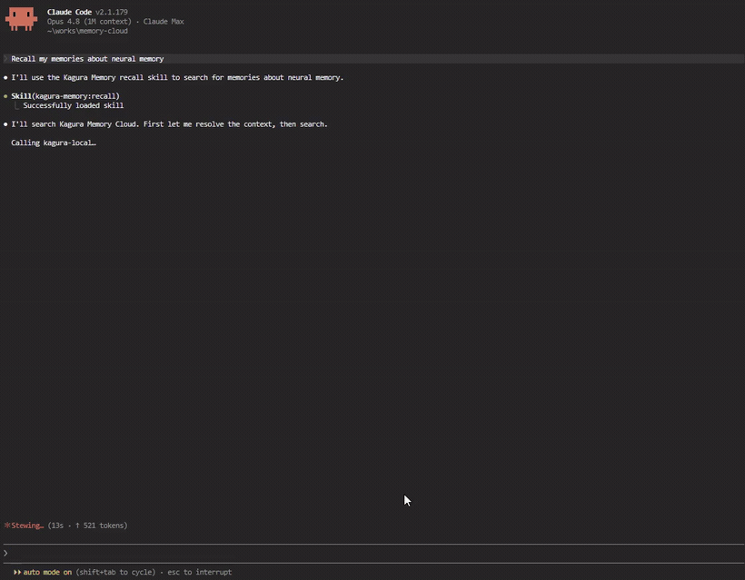

<p align="center">
  <a href="https://www.kagura-ai.com/ja/">
    <picture>
      <source media="(prefers-color-scheme: dark)" srcset="docs/assets/kagura-logo-dark.svg">
      
    </picture>
  </a>
</p>

<h1 align="center">Kagura Memory Cloud</h1>

<p align="center">
  <strong>次のAIとの会話を、これまでの続きから。</strong><br>
  あなたとチームの知識を、複数のAIエージェントで共有する記憶プラットフォーム。<br>
  オープンソース · セルフホスト対応 · MCP + REST API
</p>

<p align="center"><a href="README.md">English</a> · 日本語</p>

<p align="center">
  <a href="https://chatgpt.com/plugins/plugin_asdk_app_6adacc9eaf5481919a85fad2aaa7aade"><strong>ChatGPTで開く</strong></a> ·
  <a href="https://www.kagura-ai.com/ja/waitlist/"><strong>クラウド版の招待をリクエスト</strong></a> ·
  <a href="#クイックスタート"><strong>セルフホストで試す</strong></a> ·
  <a href="#ベンチマーク精度とコストを一緒に見る">ベンチマーク</a> ·
  <a href="docs/README.md">ドキュメント</a>
</p>

<p align="center">
  <a href="LICENSE"></a>
  <a href="https://github.com/kagura-ai/memory-cloud/releases"></a>
  <a href="https://github.com/kagura-ai/memory-cloud/actions/workflows/ci.yml"></a>
  <a href="https://modelcontextprotocol.io/"></a>
</p>

## 会話が変わっても、仕事の経緯は引き継げる

> **OpenAI Plugin公開済み：** [ChatGPTにKagura Memory Cloudを追加](https://chatgpt.com/plugins/plugin_asdk_app_6adacc9eaf5481919a85fad2aaa7aade)して、Kaguraにサインインすれば、会話の中で記憶を保存・検索できます。他のAIとの接続方法は[対応プラットフォーム](#対応プラットフォーム)をご覧ください。

昨日説明したプロジェクト。今日決めた設計と、その理由。新しいチャットを開いたり、別のAIに切り替えたり、チームに作業を渡したりするたびに、最初から説明していませんか。

**Kagura Memory Cloudは、人とAIが一緒に使える「記憶の置き場所」です。** ある会話で保存した知識を、同じワークスペース・コンテキストにつながる別のAIからも呼び出せます。Web画面で中身を確認し、編集・整理することもできます。

**ChatGPT・Claude・Codex・Cursor・Gemini・Muse・Grok・Microsoft 365 Copilot**に対応しています。ChatGPTには公開済みプラグインを追加でき、対応クライアントからはMCPでも接続できます。アプリへの組み込みにはREST APIと[Python SDK](https://github.com/kagura-ai/kagura-memory-python-sdk)も使えます。

| こんなときに | 記憶をこう使える |
|---|---|
| 久しぶりにプロジェクトを再開する | 決めたこと、制約、残っている課題を思い出す。 |
| 用途に合わせてAIを使い分ける | 同じプロジェクトの知識を、複数のツールで使う。 |
| チームで仕事を進める | ワークスペースとコンテキストの権限に応じて知識を共有する。 |
| 方針や仕様が変わる | 古い記憶を置き換え、変更履歴を残す。 |
| AIエージェントを開発する | 会話ログを丸ごと渡す代わりに、必要な記憶を検索する。 |

<p align="center">
  <a href="https://www.kagura-ai.com/demo/terminal-en-cli-2x.mp4">
    
  </a><br>
  <em>保存した記憶をAIが呼び出す様子 — <a href="https://www.kagura-ai.com/demo/terminal-en-cli-2x.mp4">デモを見る（英語）</a></em>
</p>

## クイックスタート

### 試し方を選ぶ

| | はじめ方 | 必要なもの |
|---|---|---|
| **クラウド版 Kagura AI** | [招待をリクエスト](https://www.kagura-ai.com/ja/waitlist/) · [AIクライアントを接続](https://www.kagura-ai.com/ja/help/connect/) | 招待済みのアカウントと対応AIクライアント。現在は招待制です。 |
| **セルフホスト版 Memory Cloud** | 下のセットアップを実行 | Docker Compose、Python 3.11+、Bash、埋め込みプロバイダ。 |

### 対応プラットフォーム

| クライアント | はじめ方 |
|---|---|
| **ChatGPT — OpenAI Plugin公開済み** | [Kagura Memory Cloudを追加](https://chatgpt.com/plugins/plugin_asdk_app_6adacc9eaf5481919a85fad2aaa7aade)し、Kagura AIのアカウントでサインイン。 |
| **Claude / Claude Desktop** | [リモートMCPで接続](docs/mcp-clients.md#claude-desktop--claude-chat-web)し、Kaguraにサインイン。 |
| **Claude Code** | [MCPを接続](docs/mcp-clients.md#claude-code-recommended)。任意のプラグインでセッション管理も追加。 |
| **Codex** | [MCP接続と任意のスキルプラグインを設定](docs/getting-started.md#codex-cli)。 |
| **Cursor** | [Cursorの設定にMCPサーバーを追加](docs/getting-started.md#cursor)。 |
| **Gemini / Gemini CLI** | [カスタムMCP接続](docs/mcp-clients.md#gemini-custom-mcp-connector)、または[CLI設定](docs/mcp-clients.md#gemini-cli)を利用。 |
| **Muse** | [リモートMCPサーバーを追加](docs/mcp-clients.md#muse)し、Kaguraにサインイン。 |
| **Grok / Grok Bot** | [リモートMCPで接続](docs/mcp-clients.md#grok--grok-bot)し、Kaguraにサインイン。 |
| **Microsoft 365 Copilot** | [MCP・OAuthで接続](docs/microsoft-365-copilot.md)。運用者によるOAuthクライアント設定とMicrosoft側の登録が必要。 |
| **その他のMCPクライアント・自作アプリ** | [Streamable HTTPまたはREST API](docs/mcp-clients.md#other-mcp-clients--rest-api)を利用。 |

公開済みChatGPTプラグインの接続先はクラウド版Kagura AIで、利用にはアカウントが必要です。自分で運用するMemory Cloudには[カスタムMCP接続](docs/mcp-clients.md#chatgpt-desktop)を使います。

### ローカルで起動する

Linux・macOS、またはWindowsのWSL2で、Dockerを起動して実行します。

```bash
git clone https://github.com/kagura-ai/memory-cloud.git
cd memory-cloud
bash setup.sh
```

対話形式で設定用のシークレット生成、固定バージョンのPython依存関係とKagura CLIの導入、サービス起動、DBマイグレーション、管理者アカウントとMCP設定の作成まで進みます。`uv`の導入が必要な場合は`curl`を使います。Node.jsはDocker内で動くので、ホストへのインストールはフロントエンド開発時だけ必要です。

**記憶の検索には埋め込みモデルが必要です。** OpenAI APIキー、または接続可能なセルフホストの埋め込みサーバーを設定してください。Google/GitHubログインの設定は任意で、ローカルの管理者はパスワードとMFAでログインできます。個別の手順は[セットアップガイド](docs/getting-started.md)を参照してください。

| 開く場所 | 用途 |
|---|---|
| [localhost:3000](http://localhost:3000) | ログインして記憶を管理する。 |
| `http://localhost:8080/mcp` | ローカルのMCPクライアントを接続する。 |
| [localhost:8080/redoc](http://localhost:8080/redoc) | 起動中のサーバーのREST API仕様を見る。 |

ルートのCompose構成はローカル開発用です。公開サーバーとして運用する場合は[デプロイガイド](docs/deployment.md)を使ってください。

### 最初の記憶を試す

1. Web画面で **my-first-project** というコンテキストを作成します。コンテキストは、プロジェクトやテーマごとに記憶をまとめる入れ物です。
2. [MCPクライアント設定](docs/mcp-clients.md)に従ってAIを接続します。Claude Codeではセットアップが生成する`.mcp.json`を再起動後に読み込みます。他のクライアントにはそれぞれの設定が必要です。Web版のAIから接続する場合は、手元の`localhost`ではなく、外部から到達できるHTTPSサーバーを使います。
3. AIに保存を頼みます。

   > Kaguraのmy-first-projectに覚えて：このアプリのDBにはPostgreSQLを採用した。トランザクションとリレーショナルな検索が必要だから。

4. 接続したAIで**新しい会話**を開き、聞いてみます。

   > Kaguraのmy-first-projectを検索して。DBには何を採用した？ その理由も教えて。

Web画面に記憶が残り、新しい会話で検索ツールが呼ばれることを確認してください。同じコンテキストを利用できる別のAIでも試せます。

保存するのは、あなたや連携機能が明示的に書き込んだ情報です。接続しただけで過去のチャット全体が取り込まれるわけではありません。認証情報は記憶やGitに保存しないでください。

## ベンチマーク：精度とコストを一緒に見る

「どれだけ覚えられるか」に加え、「どれだけの記憶を読めば答えられるか」。[公開ベンチマーク](https://www.kagura-ai.com/ja/benchmarks/)では、回答の正確さと費用を比較しています。

| LoCoMo：3会話・472問 | KMC v0.152.0 | 会話ログの全量入力 |
|---|---:|---:|
| 正答率（厳密な判定） | **84.2%** | 89.0% |
| 回答時に読む記憶トークン | **80%削減** | 比較基準 |
| 回答時のモデル利用費用 | **66%削減** | 比較基準 |

2026年11月10日の事前登録済み測定で、開発者自身による評価です。adversarial問題は対象外。費用に記憶の構築・サービス利用料は含みません。全量入力より正答率が下がるトレードオフもあり、データセット全体の公式スコアや、あらゆる用途での性能保証ではありません。

11月12日の**v0.156.0**での再測定は、**緩やかな判定で91.3%／厳密な判定で83.7%**でした。同じ会話での結果を見て改良した後の、事前登録なしの測定です。上の測定・費用削減率とは分けて読んでください。

**評価は継続中です。** 現在、追加の評価テストを実施し、記憶の検索精度と回答精度の改善に取り組んでいます。上記の公開結果は、記載したバージョンと測定条件でのものです。

FC・LongMemEvalの結果や比較条件は[公開レポート](https://www.kagura-ai.com/ja/benchmarks/)へ。回答の正答率と検索精度の違いは[ベンチマークの読み方](docs/benchmarks.md)にもまとめています。

## できること

| 機能 | 役立つこと |
|---|---|
| **ハイブリッド検索** | 意味による検索とBM25のキーワード検索を組み合わせる。必要に応じてリランキングも利用可能。 |
| **記憶のメンテナンス** | 編集・置き換え・変更履歴の確認・削除で、知識を更新する。 |
| **セッションの引き継ぎ** | コンテキスト、ピン留め、予定、最近の変更をまとめて読み込む。 |
| **関連する記憶の発見** | 記憶同士のグラフを探索する。対応する検索では関連付けも育つ。 |
| **チームでの共有** | ワークスペース、非公開・共有コンテキスト、ロール、スコープ付き認証情報でアクセスを管理する。 |
| **Web管理画面** | 記憶の検索・編集、履歴の確認、メンバーや連携の管理を行う。 |
| **運用方法を選べる** | Apacheライセンスのサーバーを自分で運用し、埋め込みプロバイダを選ぶ。モデル・インフラ費用は構成により異なる。 |

### MCPツール

基本は`remember`（保存）、`recall`（検索）、`reference`（詳細取得）。`bootstrap`や`changes_since`で前回の続きに戻り、事実が変わったら`update_memory`や記憶の置き換えを使います。

標準の`/mcp`は基本ツールを一覧に表示します。全ツールを使うなら`?profile=full`、グラフ探索を追加するなら`?add_tools=explore`を付けます。ツールの表示とアクセス権限は別で、ワークスペース・コンテキストの権限は引き続き適用されます。[ツール一覧とロール](docs/mcp-tools.md#tool-profiles)を参照してください。

### Claude Codeプラグイン

MCP接続後、任意のプラグインでセッション管理と記憶操作の手順を追加できます。Claude Code内で実行します。

```text
/plugin marketplace add kagura-ai/memory-cloud
/plugin install kagura-memory@kagura-memory-cloud
```

作業開始時は`/kagura-memory:session-start`、終了前は`/kagura-memory:session-summary`。日々の検索・保存・整理には`:recall`・`:remember`・`:maintain`を使えます。導入とフック設定は[MCPクライアント設定](docs/mcp-clients.md)、Codex向けは[専用のプラグイン設定](docs/getting-started.md#codex-cli)へ。

| コマンド | 用途 |
|---|---|
| `/kagura-memory:setup` | MCP接続とプラグインを設定する。 |
| `/kagura-memory:login` | Kaguraの接続にサインインし直す。 |
| `/kagura-memory:session-start` | 保存した文脈を読み込み、前回の作業を再開する。 |
| `/kagura-memory:session-summary` | セッションの決定と引き継ぎ事項を保存する。 |
| `/kagura-memory:recall` | 保存した記憶を検索する。 |
| `/kagura-memory:remember` | 指定した情報を記憶に保存する。 |
| `/kagura-memory:maintain` | 古い情報や重複を確認して整理する。 |
| `/kagura-memory:digest` | Claude Codeの会話記録から保存する知識を抽出する。 |
| `/kagura-memory:smoke-test` | MCP接続と主要な操作を検証する。 |
| `/kagura-memory:guide` | 接続状況と使い方を確認する。 |

## 仕組み

```text
人・AIクライアント ── MCP / REST ── Kagura Memory Cloud
                                    ├─ ワークスペース → コンテキスト → 記憶
                                    ├─ PostgreSQL：記録・キーワード・グラフ
                                    ├─ Qdrant：意味による検索
                                    └─ Web UI：確認・編集・共有
```

`recall`はハイブリッド検索で必要な記憶を探し、`explore`は関係をたどって知識を広げます。目的に合わせて検索と探索を使い分けられます。バックグラウンドの[Sleep Maintenance](docs/sleep-maintenance.md)は、設定に応じて記憶の統合・整理を行います。

技術スタックは**FastAPI・PostgreSQL・Qdrant・Redis・Next.js**。詳しくは[アーキテクチャ](docs/architecture.md)と[基本概念](docs/concepts.md)へ。

## ドキュメント

以下のリポジトリ内ドキュメントは英語です。クラウド版の操作案内には[日本語ヘルプ](https://www.kagura-ai.com/ja/help/)もあります。

| やりたいこと | 読むもの |
|---|---|
| インストールして最初の記憶を保存する | [Getting Started](docs/getting-started.md) |
| AIクライアントを接続する | [MCP Client Setup](docs/mcp-clients.md) |
| アプリに組み込む | [MCP Tools](docs/mcp-tools.md) · [REST API](docs/api-reference.md) · [Python SDK](https://github.com/kagura-ai/kagura-memory-python-sdk) |
| 検索しやすい記憶を書く | [Chunking Guide](docs/chunking-guide.md) · [Core Concepts](docs/concepts.md) |
| 品質・性能を評価する | [Benchmarks](docs/benchmarks.md) |
| デプロイ・運用する | [Deployment](docs/deployment.md) · [Troubleshooting](docs/troubleshooting.md) |
| 詳しいガイドを探す | [ドキュメント一覧](docs/README.md) |
| 最新の変更を知る | [リリース](https://github.com/kagura-ai/memory-cloud/releases) · [Changelog](CHANGELOG.md) |

## コントリビューション

不具合報告、ドキュメント改善、機能への貢献を歓迎します。[CONTRIBUTING.md](CONTRIBUTING.md)をご覧ください。脆弱性の報告は[SECURITY.md](SECURITY.md)へ。

## ライセンス

[Apache License 2.0](LICENSE)。
