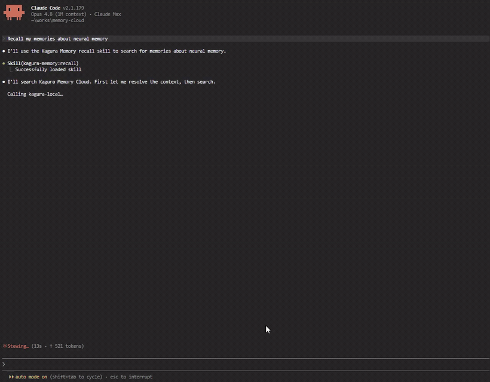

<p align="center">
  <a href="https://www.kagura-ai.com/">
    <picture>
      <source media="(prefers-color-scheme: dark)" srcset="docs/assets/kagura-logo-dark.svg">
      
    </picture>
  </a>
</p>

<h1 align="center">Kagura Memory Cloud</h1>

<p align="center">
  <strong>Your next AI conversation starts with what you already know.</strong><br>
  Shared, persistent memory for people, teams, and AI agents.<br>
  Open source · Self-hostable · MCP + REST API
</p>

<p align="center">English · <a href="README.ja.md">日本語</a></p>

<p align="center">
  <a href="https://chatgpt.com/plugins/plugin_asdk_app_6adacc9eaf5481919a85fad2aaa7aade"><strong>Open in ChatGPT</strong></a> ·
  <a href="https://www.kagura-ai.com/waitlist/"><strong>Request a cloud invite</strong></a> ·
  <a href="#quick-start"><strong>Self-host</strong></a> ·
  <a href="docs/benchmarks.md">Benchmarks</a> ·
  <a href="docs/README.md">Documentation</a>
</p>

<p align="center">
  <a href="LICENSE"></a>
  <a href="https://github.com/kagura-ai/memory-cloud/releases"></a>
  <a href="https://github.com/kagura-ai/memory-cloud/actions/workflows/ci.yml"></a>
  <a href="https://modelcontextprotocol.io/"></a>
</p>

## Keep the context. Change the conversation.

> **DolphinBench: 455 of 600 tasks (75.8%), self-tested on November 23, 2026.** With Hermes and GPT 5.6 Luna, Kagura Memory Cloud passed more tasks than each memory system in the benchmark's published Hermes + Luna results (Mem0 424, Hindsight 417, Honcho 411). The run is self-reported and awaits the maintainers' review: [run record](https://github.com/mem0ai/dolphinbench/pull/16) · [evidence](https://github.com/kagura-ai/dolphinbench/releases/tag/kagura-memory-cloud-hermes-20261123) · [comparison](#dolphinbench-memory-for-an-agent-that-acts).

> **OpenAI Plugin released:** [Kagura Memory Cloud is available in ChatGPT](https://chatgpt.com/plugins/plugin_asdk_app_6adacc9eaf5481919a85fad2aaa7aade). Add the plugin and sign in to Kagura to save and recall memories in your conversations. See [supported platforms](#supported-platforms) for the other ways to connect.

You explained the project yesterday. Today you open a new chat, switch AI tools, or hand work to a teammate. The decisions and their reasons should come with you.

**Kagura Memory Cloud gives your assistants a shared place to remember and recall that knowledge.** Save a decision in one session; retrieve it in another client connected to the same workspace and context. Browse, edit, and organize the memories in the web UI.

It works with **ChatGPT, Claude, Codex, Cursor, Gemini, Muse, Grok, and Microsoft 365 Copilot**. Use the published ChatGPT plugin or connect a compatible client over MCP. Applications can also use the REST API or [Python SDK](https://github.com/kagura-ai/kagura-memory-python-sdk).

| When you… | Use shared memory to… |
|---|---|
| Resume a project | Recover decisions, constraints, and unresolved work. |
| Switch AI assistants | Reuse the same project knowledge across tools. |
| Work with a team | Share knowledge through workspace and context roles. |
| Change a decision | Replace an outdated memory and retain its history. |
| Build an agent | Retrieve relevant context without sending the entire conversation log. |

<p align="center">
  <a href="https://www.kagura-ai.com/demo/terminal-en-cli-2x.mp4">
    
  </a><br>
  <em>See memory retrieval in action — <a href="https://www.kagura-ai.com/demo/terminal-en-cli-2x.mp4">watch the demo</a>.</em>
</p>

## Quick start

### Choose how to try it

| | Start here | What you need |
|---|---|---|
| **Hosted Kagura AI** | [Request an invite](https://www.kagura-ai.com/waitlist/) · [Connect your AI client](https://www.kagura-ai.com/help/connect/) | An invited account and a compatible AI client. Cloud registration is currently invite-only. |
| **Self-hosted Memory Cloud** | Run the setup below | Docker Compose, Python 3.11+, Bash, and an embedding provider. |

### Supported platforms

| Client | Start here |
|---|---|
| **ChatGPT — released OpenAI Plugin** | [Add Kagura Memory Cloud](https://chatgpt.com/plugins/plugin_asdk_app_6adacc9eaf5481919a85fad2aaa7aade), then sign in to your Kagura AI account. |
| **Claude / Claude Desktop** | [Connect over remote MCP](docs/mcp-clients.md#claude-desktop--claude-chat-web) and sign in to Kagura. |
| **Claude Code** | [Connect MCP](docs/mcp-clients.md#claude-code-recommended); add the optional plugin for session workflows. |
| **Codex** | [Connect MCP and install the optional skill plugin](docs/getting-started.md#codex-cli). |
| **Cursor** | [Add the MCP server in Cursor settings](docs/getting-started.md#cursor). |
| **Gemini / Gemini CLI** | Use a [custom MCP connector](docs/mcp-clients.md#gemini-custom-mcp-connector) or the [CLI configuration](docs/mcp-clients.md#gemini-cli). |
| **Muse** | [Add a remote MCP server](docs/mcp-clients.md#muse) and sign in to Kagura. |
| **Grok / Grok Bot** | [Connect over remote MCP](docs/mcp-clients.md#grok--grok-bot) and sign in to Kagura. |
| **Microsoft 365 Copilot** | [Connect through MCP and OAuth](docs/microsoft-365-copilot.md), with operator setup of the OAuth client and Microsoft registration. |
| **Other MCP clients / your own apps** | Use [Streamable HTTP or the REST API](docs/mcp-clients.md#other-mcp-clients--rest-api). |

The published ChatGPT plugin connects to hosted Kagura AI and requires an account. For your own Memory Cloud deployment, use the [custom MCP connection instructions](docs/mcp-clients.md#chatgpt-desktop).

### Run locally

On Linux, macOS, or Windows with WSL2, with Docker running:

```bash
git clone https://github.com/kagura-ai/memory-cloud.git
cd memory-cloud
bash setup.sh
```

The interactive setup generates configuration secrets, installs the pinned Python dependencies and Kagura CLI, starts the services, runs migrations, and creates an admin account and MCP configuration. It uses `curl` if it needs to install `uv`. Node.js runs inside Docker; a host Node.js installation is only needed for frontend development.

**Memory search needs embeddings:** configure an OpenAI API key or a reachable self-hosted embedding server. Google/GitHub sign-in is optional; the local admin can use a password and MFA. See the [setup guide](docs/getting-started.md) for manual steps and provider configuration.

| Open | Purpose |
|---|---|
| [localhost:3000](http://localhost:3000) | Sign in and manage your memories. |
| `http://localhost:8080/mcp` | Connect a local MCP client. |
| [localhost:8080/redoc](http://localhost:8080/redoc) | Explore the running server's REST API. |

The root Compose stack is for local development. For a public server, use the [deployment guide](docs/deployment.md).

### Try your first memory

1. In the web UI, create a context named **my-first-project**. A context groups memories for a project or topic.
2. Connect your AI client using [MCP Client Setup](docs/mcp-clients.md). For Claude Code, setup generates a local `.mcp.json`; restart the client to load it. Other clients have their own configuration. Web-based clients need a reachable HTTPS server, rather than your machine's `localhost`.
3. Ask the assistant:

   > In Kagura's my-first-project context, remember: we chose PostgreSQL because the app needs transactions and relational queries.

4. Open a **new conversation** with the connected client and ask:

   > Search Kagura's my-first-project context. Which database did we choose, and why?

Look for the saved memory in the web UI and a recall tool call in the new conversation. Then repeat the question in another client with access to the same context.

Kagura stores what you or an integration explicitly saves. Connecting a client does not automatically import all of its past chats. Keep credentials out of memories and version control.

## Benchmarks: accuracy and cost together

How much history does an assistant need to answer well? Our [public benchmark report](https://www.kagura-ai.com/ja/benchmarks/) measures answer quality as well as cost.

| LoCoMo, 472 questions across 3 conversations | KMC v0.152.0 | Full conversation input |
|---|---:|---:|
| Answer accuracy, strict grading | **84.2%** | 89.0% |
| Memory tokens read at answer time | **80% fewer** | Baseline |
| Answer-time model cost | **66% lower** | Baseline |

These are developer-run, preregistered results from November 10, 2026, excluding adversarial questions. Costs exclude memory construction and service fees. The tradeoff includes lower accuracy than full-history input; these are not official full-dataset scores or a guarantee for your workload.

A November 12 rerun of **v0.156.0** scored **91.3% with lenient grading / 83.7% with strict grading**. It reused the same conversations after tuning and was not preregistered. Keep it separate from the original run and its cost measurements.

### DolphinBench: memory for an agent that acts

[DolphinBench](https://github.com/mem0ai/dolphinbench) gives an agent three people's histories (13,539 messages) and then 600 tasks in simulated apps; a task passes only if the agent acts correctly on what it should remember. We ran it with the benchmark's Hermes setup and GPT 5.6 Luna, with Kagura Memory Cloud as the memory.

| Memory (Hermes + GPT 5.6 Luna) | Tasks passed, of 600 | Source |
|---|---:|---|
| **Kagura Memory Cloud v0.156.0** | **455 (75.8%)** | Self-tested, November 23, 2026; [under review](https://github.com/mem0ai/dolphinbench/pull/16) |
| Mem0 | 424 (70.7%) | Published by the benchmark |
| Hindsight | 417 (69.5%) | Published by the benchmark |
| Honcho | 411 (68.5%) | Published by the benchmark |
| Hermes built-in memory | 394 (65.7%) | Published by the benchmark |
| Supermemory | 355 (59.2%) | Published by the benchmark |

Read the comparison with these limits:

- **Self-tested.** The benchmark's maintainers have not verified our run. The published rows are theirs.
- **Not held out.** We chose the plugin's recall settings after reading failures on the public tasks.
- **Judge route.** The judge is the benchmark's model, settings and prompts, sent through the OpenAI API instead of Azure.
- **Cost.** $97.90 of agent tokens at the benchmark's prices. The memory server's own models ran self-hosted and are not included.
- **Other self-tested runs** awaiting review report 451 to 504 tasks, most with a different harness.

Everything needed to check the score is public: the [run record and method note](https://github.com/kagura-ai/dolphinbench/blob/kagura-memory-cloud-hermes-20261123/docs/submissions/kagura-memory-cloud-hermes-20261123.md), the [evidence ZIP](https://github.com/kagura-ai/dolphinbench/releases/tag/kagura-memory-cloud-hermes-20261123) with all 600 task conversations and saved judge answers, and the plugin and adapter source at the same tag.

**Evaluation is ongoing.** We are running additional evaluations and working to improve memory retrieval and answer accuracy. The published results above reflect the tested versions and conditions.

See the [benchmark reading guide](docs/benchmarks.md) for FC and LongMemEval results, comparison limits, and the distinction between answer accuracy and retrieval metrics. [English public report](https://www.kagura-ai.com/benchmarks/) · [日本語・LoCoMo詳細](https://www.kagura-ai.com/ja/benchmarks/)

## What you get

| Capability | How it helps |
|---|---|
| **Hybrid retrieval** | Semantic search + BM25 keyword matching, with optional reranking. |
| **Memory you can maintain** | Update, supersede, inspect revisions, and remove outdated knowledge. |
| **Session continuity** | Bootstrap a session with context, pinned notes, upcoming items, and recent changes. |
| **Related-memory discovery** | Explore a graph of related memories; supported searches can strengthen associations. |
| **Team controls** | Workspaces, private/shared contexts, roles, and scoped credentials. |
| **Web management** | Search and edit memories, inspect history, manage members and integrations. |
| **Your deployment choice** | Self-host the Apache-licensed server and choose your embedding provider. Model and infrastructure costs depend on that choice. |

### MCP tools

Start with `remember`, `recall`, and `reference`. Session tools such as `bootstrap` and `changes_since` help an agent pick up previous work. Use `update_memory` or supersession when a fact changes.

The default `/mcp` endpoint lists the core tools. Add `?profile=full` for the full catalog, or `?add_tools=explore` for graph exploration. Tool visibility and access permissions are separate; workspace and context roles still apply. See [tool profiles and roles](docs/mcp-tools.md#tool-profiles).

### Getting started with Claude Code

Once MCP is connected, the optional plugin adds guided session and memory workflows. In Claude Code:

```text
/plugin marketplace add kagura-ai/memory-cloud
/plugin install kagura-memory@kagura-memory-cloud
```

Use `/kagura-memory:session-start` when you return to a project and `/kagura-memory:session-summary` to save useful knowledge before leaving. `/kagura-memory:recall`, `:remember`, and `:maintain` support day-to-day use. Installation and hook configuration are covered in [MCP Client Setup](docs/mcp-clients.md); Codex users have a [separate plugin setup](docs/getting-started.md#codex-cli).

## How it works

```text
People and AI clients  ── MCP / REST ──  Kagura Memory Cloud
                                       ├─ Workspace → contexts → memories
                                       ├─ PostgreSQL: records, keywords, graph
                                       ├─ Qdrant: semantic retrieval
                                       └─ Web UI: browse, edit, share
```

`recall` finds relevant memories through hybrid search. `explore` follows relationships for discovery. Keeping these paths separate lets you choose direct retrieval or related knowledge. Background [Sleep Maintenance](docs/sleep-maintenance.md) consolidates memory according to configuration.

Built with **FastAPI, PostgreSQL, Qdrant, Redis, and Next.js**. Read the [architecture](docs/architecture.md) and [core concepts](docs/concepts.md) for the underlying design.

## Documentation

| I want to… | Read |
|---|---|
| Install and save my first memory | [Getting Started](docs/getting-started.md) |
| Connect an AI client | [MCP Client Setup](docs/mcp-clients.md) |
| Build an integration | [MCP Tools](docs/mcp-tools.md) · [REST API](docs/api-reference.md) · [Python SDK](https://github.com/kagura-ai/kagura-memory-python-sdk) |
| Write useful memories | [Chunking Guide](docs/chunking-guide.md) · [Core Concepts](docs/concepts.md) |
| Evaluate quality | [Benchmarks](docs/benchmarks.md) |
| Deploy and operate | [Deployment](docs/deployment.md) · [Troubleshooting](docs/troubleshooting.md) |
| Find a specialist guide | [Documentation index](docs/README.md) |
| See what changed | [Releases](https://github.com/kagura-ai/memory-cloud/releases) · [Changelog](CHANGELOG.md) |

## Contribute

Bug reports, documentation improvements, and contributions are welcome. Start with [CONTRIBUTING.md](CONTRIBUTING.md). Report vulnerabilities through [SECURITY.md](SECURITY.md).

## License

[Apache License 2.0](LICENSE).
